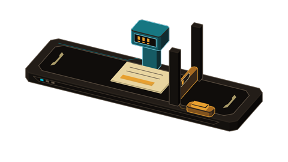

# x10aix Anatomy

Schlanker Fork von [wheresryan22/anatomy](https://github.com/wheresryan22/anatomy): unverändertes Geometrie-Kit, eigener Skill-Einstieg und zwei Modi in x10aix Leiterbahn-/Retro-Sci-Fi-CI.



## Zwei Modi

- **Videoeinblendung:** wenige große Funktionsgruppen, deterministische Zeitsteuerung, optional transparenter ProRes-Export. Bei 480 × 270 prüfen.
- **Web-Erklärer:** mehr erklärender Detailgrad, interaktive Zustände, Pause, Tastatur und reduzierte Bewegung.

Einstieg: [SKILL.md](SKILL.md). Die pauschale Detailpflicht des Originals wird durch Lesbarkeit im Ausgabemedium ersetzt. Geometrieprüfungen bleiben erhalten.

## Beispiel lokal aufbauen

Node.js 22 oder neuer:

```sh
cd x10aix
npm ci
npm run build:video
npm run check
node scripts/serve.mjs
```

`http://127.0.0.1:4790/` öffnen. Für die ausführliche Variante `npm run build:web` ausführen und neu laden. Zurück mit `npm run build:video`. Der Build ersetzt nur generierte Beispielausgaben. Das Beispiel simuliert fünf Schritte der Dokumentprüfung; erst nach menschlicher Prüfung erfolgt die Freigabe.

Ausgaben: `example/web-anatomy.html`, einfacher Ablauf als Vergleich und HyperFrames-Kompositionen unter `example/film-anatomy/` und `example/film-einfach/`. Keine externen CDNs im Browser. GSAP über Lockfile, lokale Schriften mit Lizenz.

## Videoexport

Mit separat installierter, geprüfter HyperFrames-Version (Referenzproduktion: 0.8.141) und FFmpeg:

```sh
hyperframes check example/film-anatomy
hyperframes render example/film-anatomy --fps 30 --quality delivery --output dokumentpruefung.mp4
node scripts/overlay.mjs
hyperframes check example/film-overlay
hyperframes render example/film-overlay --format mov --fps 30 --output maschine-alpha.mov
```

Die lokale CLI kann über ihren Pfad aufgerufen werden; kein globales Update erforderlich. Alpha am tatsächlichen Export prüfen. Große fertige Videos werden nicht im Repo abgelegt.

## Herkunft und Pflege

Upstream-Pin: `1482e8469b0a9e0d8cc18ea2740a01423d29ae80`. `kit/` bleibt bytegleich. Anpassungen unter `x10aix/`, im Skill-Einstieg, README und Agentenlabel. `main` bewahrt den Upstream-Ausgangspunkt; **`x10aix` ist der Default-Branch**. Updates separat prüfen. [Wartung](x10aix/references/maintenance.md).

Versionierte [CI-Referenz](x10aix/references/ci-retro-scifi.md): Stand 2026-10-23. Markenänderungen im zentralen Leitfaden und hier gemeinsam pflegen. [Original-README](x10aix/upstream/README.md) und [Original-Skill](x10aix/upstream/SKILL.md) dokumentieren die Herkunft.

Anatomy: Copyright Ryan, MIT, siehe [LICENSE](LICENSE). x10aix-spezifischer Code und Dokumentation: Copyright 2026 X10AIX GmbH, ebenfalls MIT. Fonts und GSAP besitzen eigene Lizenzbedingungen; siehe `x10aix/example/assets/OFL-*.txt` und die installierte GSAP-Lizenz. Keine behauptete Verbindung mit den genannten Spieleherstellern.
